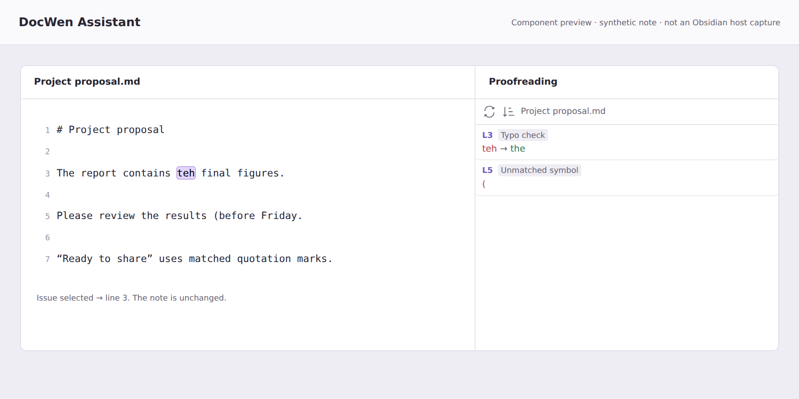
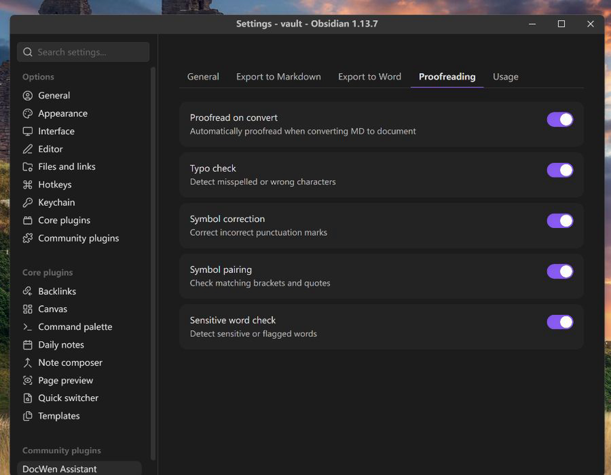
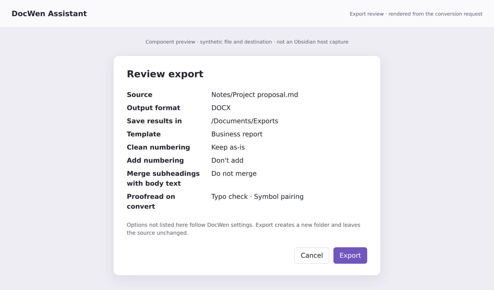

# DocWen Assistant

[English](../../README.md) · [简体中文](README.zh-CN.md) · [繁體中文](README.zh-TW.md) · [日本語](README.ja-JP.md) · [한국어](README.ko-KR.md) · [Deutsch](README.de-DE.md) · [Français](README.fr-FR.md) · [Español](README.es-ES.md) · [Português (Brasil)](README.pt-BR.md) · [Русский](README.ru-RU.md) · [Tiếng Việt](README.vi-VN.md) · [العربية](README.ar.md)

DocWen Assistant conecta Obsidian con una instalación local de [DocWen](https://github.com/ZHYX91/docwen). Requiere Windows o Linux, Obsidian 1.12.7 o posterior y una versión estable de DocWen 0.17.0 o posterior.

> **DocWen es obligatorio.** Instala una versión compatible desde [Microsoft Store](https://apps.microsoft.com/detail/9NR2211SJH97) o extrae por completo el ZIP portátil de [DocWen Releases](https://github.com/ZHYX91/docwen/releases).

El idioma de la interfaz solo cambia los textos y el diseño de Assistant. El idioma de conversión, las plantillas y el OCR se controlan mediante las opciones de la tarea y los ajustes de DocWen.

## Capturas de pantalla

Ejemplos de la interfaz de escritorio. La revisión utiliza una nota de prueba.

### Barra lateral de revisión

Revisa problemas por línea o regla y vuelve al intervalo de origen correspondiente sin reescribir la nota.

### Configuración y conexión con DocWen

Comprueba la conexión con DocWen y elige las opciones de conversión y revisión en las cuatro pestañas.

### Exportar archivos

Elige el formato de salida, revisa las opciones e indica dónde guardar el resultado.

## Funciones

El complemento abre archivos en DocWen, exporta Word/Excel/Markdown a una salida elegida, gestiona la numeración de encabezados Markdown, revisa Markdown y ofrece **Comprobar conexión con DocWen**.

## Requisitos y compatibilidad

- Windows o Linux y Obsidian 1.12.7 o posterior; el complemento es solo para escritorio.
- En Windows, usa una versión compatible de DocWen 0.17.0 o posterior de Store o un paquete portátil totalmente extraído; en Linux, usa un paquete totalmente extraído seleccionado manualmente. La exportación en Linux requiere x64 y un sistema de archivos que guarde nuevos resultados sin sobrescribir datos existentes; el complemento no descarga DocWen automáticamente.
- El complemento requiere `docwen.machine.v2` y `docwen.artifact_bundle.v3`; una versión incompatible de DocWen se rechaza en lugar de usar otro protocolo.
- Aunque la conexión para convertir en segundo plano sea incompatible, puedes intentar abrir la aplicación DocWen por separado.

Si la instalación de Store no cumple estos requisitos, utiliza un paquete portátil compatible y selecciónalo mediante la instalación manual.

La detección automática es exclusiva de Windows, usa el alias registrado `docwen.exe` y sigue funcionando tras las actualizaciones de Microsoft Store. En Linux, la instalación manual es obligatoria y acepta la carpeta extraída, `DocWen` o `DocWenCLI`. El complemento no busca programas en carpetas arbitrarias y no descarga software automáticamente.

## Instalación

### Instalar DocWen y el complemento

1. En Windows, instala una versión compatible de DocWen 0.17.0 o posterior desde [Microsoft Store](https://apps.microsoft.com/detail/9NR2211SJH97), o extrae el paquete Windows de [DocWen Releases](https://github.com/ZHYX91/docwen/releases). En Linux x64, extrae por completo el paquete Linux de la misma página.
2. Instala DocWen Assistant desde Community Plugins. Para instalarlo manualmente, descarga `docwen-assistant-x.y.z.zip` desde las [versiones del complemento](https://github.com/ZHYX91/obsidian-docwen-assistant/releases) y copia `main.js`, `manifest.json` y `styles.css` en `<Vault>/.obsidian/plugins/docwen-assistant/`.
3. Recarga Community Plugins y activa DocWen Assistant.
4. La versión Windows de Store puede detectarse automáticamente. En Windows portátil o Linux, abre **Configuración → DocWen Assistant → General**, elige la conexión manual y selecciona la carpeta extraída o el ejecutable.

### Conservar los ajustes al actualizar

Al actualizar manualmente, sustituye solo `main.js`, `manifest.json` y `styles.css`. Conserva `data.json` para mantener los ajustes; bórralo solo si quieres restablecerlos. Mantén el nombre de carpeta `docwen-assistant`.

## Uso

**Los comandos dependen del archivo abierto.** La conversión solo está disponible si el DocWen conectado admite esa operación para el contenido. Exportar guarda una salida independiente y revisar el texto no modifica la nota. **Añadir o quitar números de encabezado sí modifica el Markdown.** Antes de escribir se comprueba el contenido del editor, incluidos los cambios sin guardar, o el archivo almacenado; si hay varios editores ambiguos para la misma ruta, se detiene.

El icono, el submenú **DocWen** y la paleta de comandos permiten iniciar DocWen, exportar Word/Excel/Markdown, cambiar la numeración de encabezados, revisar Markdown y elegir **Comprobar conexión con DocWen**.

Elige una plantilla o un preajuste de conversión si se ofrece y, después, una carpeta de salida. Revisa el origen, formato, destino y opciones y pulsa **Exportar**. La ventana usa los ajustes capturados para esa tarea; al cancelar no comienza la conversión. Un DOCX o XLSX único se guarda directamente en la carpeta elegida cuando DocWen devuelve un archivo. Markdown y las salidas agrupadas conservan su propia carpeta con imágenes y adjuntos. Al terminar, pulsa **Abrir carpeta del resultado** en la notificación. Esta acción abre la carpeta que contiene la salida. No se sustituyen archivos ni carpetas existentes.

## Configuración

Antes de exportar a Word, activa las **extensiones de entrada** necesarias en **DocWen → Configuración → Sintaxis Markdown**. Están desactivadas en una instalación nueva; también puedes usar el preajuste de entrada de Obsidian.

| Contenido o tarea | Ajuste en DocWen |
| --- | --- |
| Celdas combinadas de Structural Tables | Extensión de entrada Structural Tables |
| Leyendas y referencias de Number Suite | Extensión de entrada de leyendas y referencias |
| Títulos H7–H9 / notas finales tipadas | Extensiones de entrada correspondientes |
| Word a Markdown extendido | Extensiones de salida correspondientes |

La exportación a Word lee la sintaxis de Number Suite aunque ese complemento no esté instalado. Los números exportados siguen los ajustes de DocWen, no los números que Number Suite solo muestra en pantalla. Los comandos de añadir o quitar números de encabezado sí modifican la nota original; exportar no la modifica.

**Qué modifica cada proyecto**

| Proyecto y guía | Visualización, origen y salida |
| --- | --- |
| [DocWen (Core)](https://github.com/ZHYX91/docwen/blob/main/docs/user-guides/README.es-ES.md) | Crea los archivos convertidos. Las extensiones de entrada interpretan la sintaxis original; los ajustes de exportación determinan el resultado y su numeración. |
| [DocWen Assistant](../product-requirements.en.md) | La exportación guarda una salida independiente; la revisión solo lee. Las acciones explícitas de numeración de encabezados modifican el Markdown original. |
| [Chrono Notes](https://github.com/ZHYX91/obsidian-chrono-notes/blob/main/docs/i18n/README.es-ES.md) | Las vistas del calendario y las tareas leen el índice. Cambiar el estado o la fecha de una tarea modifica su Markdown original; las acciones de creación añaden notas. |
| [Property Order](https://github.com/ZHYX91/obsidian-property-order/blob/main/docs/i18n/README.es-ES.md) | Los ajustes de sugerencias cambian los menús. Reordenar o mover valores edita las listas YAML afectadas y puede convertir valores no textuales en cadenas. |
| [Link Integrity](https://github.com/ZHYX91/obsidian-link-integrity/blob/main/docs/i18n/README.es.md) | Las reglas filtran los resultados del análisis o determinan qué conexiones del grafo se cuentan. No reescriben los enlaces de las notas. |
| [Folder Nodes](https://github.com/ZHYX91/obsidian-folder-nodes/blob/main/docs/i18n/README.es.md) | Las vistas muestran la estructura de nodos. Crear, mover, renombrar, fusionar y eliminar modifica notas, carpetas o propiedades estructurales. |
| [Number Suite](https://github.com/ZHYX91/obsidian-number-suite/blob/main/docs/i18n/README.es.md) | Los números virtuales cambian la visualización. Los ajustes por nota guardan propiedades; escribir, eliminar o renumerar cambia el texto de los encabezados. |
| [Structural Tables](https://github.com/ZHYX91/obsidian-structural-tables/blob/main/docs/i18n/README.es.md) | Ver tablas y la muestra de apariencia no modifica las notas. Editar tablas escribe Markdown; convertir a Base crea archivos de registros. |

La configuración se divide en cuatro pestañas: General, Exportar a Markdown, Exportar a Word y Corrección. Las explicaciones aparecen junto a las opciones correspondientes. El idioma sigue a Obsidian de forma predeterminada y puede elegirse en la configuración general. Usa las flechas o las teclas Inicio/Fin para cambiar de pestaña.

## Limitaciones

- Para escritorio Windows o Linux con una instalación local compatible de DocWen; la exportación en Linux requiere x64 y un sistema de archivos que guarde resultados sin sobrescribir datos existentes.
- No hay búsqueda recursiva fuera de la carpeta o programa DocWen seleccionado.
- Si la nota cambia durante el proceso o el resultado no se puede guardar con seguridad, la operación se detiene y te pide que lo revises.

Convertir a Word y volver a Markdown no sustituye una copia del original. El contenido visible compatible se puede recuperar, pero algunas sintaxis, las notas incrustadas y ciertos detalles de formato pueden perderse. Conserva la nota original y revisa el documento convertido.

## Privacidad y seguridad

Tus documentos permanecen en tu equipo. El complemento pasa a DocWen local una copia temporal del archivo elegido, incluidos los cambios sin guardar si hay un único editor correspondiente. Añade las imágenes referenciadas expresamente; no busca archivos ajenos por todo el Vault ni sube documentos a Internet.

La exportación escribe en la carpeta que elijas y la revisión no modifica la nota. Los números de encabezado solo se guardan si la nota original sigue en la misma ruta y su texto no ha cambiado. Si renombras o sustituyes la nota durante el proceso, vuelve a ejecutar la acción sobre la nota actual. La ruta de instalación de Store no se guarda en los ajustes del complemento. Consulta la [especificación de integración](../cli-integration.md) para los detalles técnicos.

## Desarrollo

Usa Node.js 24.19.0 y npm 11.17.0. Ejecuta `npm ci`, `npm run check` y `npm run release`. El código fuente está en `src/`, las pruebas en `tests/`; los archivos generados en `dist/` y `release/` no son código fuente.

Documentos estables: [Requisitos del producto](../product-requirements.en.md) · [Especificación de UX](../ux-spec.en.md) · [Arquitectura](../architecture.en.md) · [Estrategia de pruebas](../testing-strategy.en.md)

Gobernanza del repositorio: [Registro de cambios](../../CHANGELOG.md) · [Cómo contribuir](../../CONTRIBUTING.md) · [Seguridad](../../SECURITY.md)

## Soporte

En Obsidian, abre **General → Ayuda** y elige **Guía del usuario** o **Informar de un problema**.

- [Q&A](https://github.com/ZHYX91/obsidian-docwen-assistant/discussions/categories/q-a): Preguntas de uso y configuración.
- [Ideas](https://github.com/ZHYX91/obsidian-docwen-assistant/discussions/categories/ideas): Ideas iniciales de funciones y flujos de trabajo.
- [Show and tell](https://github.com/ZHYX91/obsidian-docwen-assistant/discussions/categories/show-and-tell): Consejos, flujos de trabajo e implementaciones de referencia.
- Envía errores reproducibles de integración con Obsidian y propuestas concretas mediante los [formularios de incidencias de DocWen Assistant](https://github.com/ZHYX91/obsidian-docwen-assistant/issues/new/choose).
- Para conversión, OCR, revisión o comportamiento de CLI fuera de Obsidian, usa [DocWen Core Issues](https://github.com/ZHYX91/docwen/issues).
- Informa de vulnerabilidades de forma privada según la [política de seguridad](https://github.com/ZHYX91/obsidian-docwen-assistant/security/policy).

Antes de publicar, elimina contenido privado de documentos, rutas de archivos y Vault, registros de CLI, ubicaciones de ejecutables y credenciales.

## Licencia

MIT © ZhengYX
